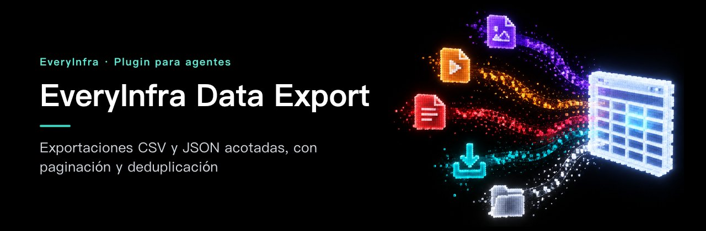

# EveryInfra Data Export — Exportaciones CSV y JSON acotadas, con paginación y deduplicación

<!-- rq223-banner -->
<p align="center"></p>

<p align="center">
  <picture>
    <source media="(prefers-color-scheme: dark)" srcset="assets/hero-dark.svg">
    <source media="(prefers-color-scheme: light)" srcset="assets/hero-light.svg">
    
  </picture>
</p>

<p align="center">
  <a href="https://cursor.com/en/install-mcp?name=everyinfra&config=eyJ1cmwiOiJodHRwczovL2FwaS5ldmVyeWluZnJhLmNvbS9tY3AiLCJoZWFkZXJzIjp7IkF1dGhvcml6YXRpb24iOiJCZWFyZXIgPEFQSSBLZXk%2BIn19"></a>
  <a href="https://vscode.dev/redirect/mcp/install?name=everyinfra&config=%7B%22type%22%3A%22http%22%2C%22url%22%3A%22https%3A%2F%2Fapi.everyinfra.com%2Fmcp%22%2C%22headers%22%3A%7B%22Authorization%22%3A%22Bearer%20%3CAPI%20Key%3E%22%7D%7D"></a>
  <a href="https://github.com/everyinfra/everyinfra-agent-plugins/blob/main/i18n/README.es.md#claude-code"></a>
  <a href="https://github.com/everyinfra/everyinfra-agent-plugins/blob/main/i18n/README.es.md#codex"></a>
</p>

<p align="center">
  <a href="https://github.com/everyinfra/everyinfra-agent-plugins/stargazers"></a>
  &nbsp;<b>Dale una estrella al repo principal y recibe $1 de saldo.</b> <a href="https://everyinfra.com/es/docs?utm_source=github&utm_medium=readme&utm_campaign=everyinfra-data-export-plugin&utm_content=star_line#quickstart">Cómo reclamarlo →</a>
</p>

<p align="center"><a href="README.md">English</a> · <a href="README.zh-CN.md">简体中文</a> · <b>Español</b></p>

> [!TIP]
> **Este repositorio contiene una sola skill: EveryInfra Data Export.** El plugin completo de EveryInfra (10 skills, el servidor MCP remoto en `https://api.everyinfra.com/mcp` y la configuración para Claude Code, Codex, Cursor y VS Code) está en **[everyinfra/everyinfra-agent-plugins](https://github.com/everyinfra/everyinfra-agent-plugins)**. Los botones de arriba conectan el servidor MCP; la instalación del plugin en cada entorno está en el repo principal.

[Configuración](docs/setup.md) · [Flujo de trabajo](docs/workflow.md) · [Prompts](examples/prompts.md) · [Referencia de capacidades](docs/reference.md) · [Documentación de la API](https://api.everyinfra.com/docs) <sub>(en inglés)</sub>

EveryInfra Data Export es una skill independiente para exportar a CSV y JSON con límites usando EveryData MCP. Controla los límites de filas y de coste, vigila el avance de la paginación, elimina duplicados y verifica el archivo final antes de darlo por entregado.

Úsala cuando el entregable es un archivo y no una respuesta en prosa. Incluye las instrucciones de descubrimiento y recogida necesarias; no hace falta otro plugin.

## Qué puedes hacer

- Recoger un número concreto de registros públicos compatibles sin bucles sin fin.
- Conservar los datos anidados en JSON o mantener estables las cabeceras del CSV entre páginas.
- Entregar un archivo con el número real de registros, el de duplicados y la explicación de cualquier corte.

## Instalación

Es un paquete independiente con una sola skill y un flujo de trabajo **MCP**; no es un servicio nuevo. Necesita un entorno de agente compatible y el acceso configurado que describe la [guía de configuración](docs/setup.md). Validar el paquete en local no demuestra que la API esté disponible.

Revisa el contenido del repositorio y luego instálalo en Codex. Estos comandos añaden un catálogo respaldado por GitHub, no un aval de ningún marketplace oficial:

```bash
codex plugin marketplace add everyinfra/everyinfra-data-export-plugin
codex plugin add everyinfra-data-export@everyinfra-data-export-plugin
```

Para una copia local, cambia la fuente del primer comando por `.`. La [guía de configuración](docs/setup.md) también cubre Claude Code y la conexión al servicio, que va aparte.

Con el acceso configurado, prueba:

> Planifica una exportación a CSV de hasta el número de filas que te indique. Revisa los campos admitidos, la paginación y las llamadas estimadas antes de recoger datos.

Este primer prompt solo inspecciona o prepara. Revisa cualquier operación de pago o efecto externo antes de seguir.

## Cómo funciona

1. Confirma fuente, filas pedidas, campos, formato, destino y límite de tiempo o de coste.
2. Descubre el esquema de la acción con `everyinfra_list_capabilities`, incluidos la paginación y `max_limit`.
3. Estima las llamadas cuando el contrato lo permita y pide aprobación antes de un gasto relevante.
4. Usa `everyinfra_call_api` con reintentos acotados y para al llegar al objetivo, al presupuesto, a la última página o a un cursor que no avanza.
5. Elimina duplicados con un ID estable o una clave compuesta documentada y escribe los campos elegidos.
6. Verifica que el archivo existe, no está vacío, se puede parsear y tiene las filas que dice. Informa de filas pedidas frente a entregadas y de todos los motivos de corte.

**Un buen resultado:** un archivo real y parseable, con filas pedidas y entregadas, la regla de deduplicación, el motivo de parada y lo cobrado. Una ruta no es un entregable si el archivo no existe y no pasa la validación.

## Límites y seguridad

- No hay exportación ilimitada, cobertura total de una plataforma ni reintentos sin fin.
- Los fallos de autorización, parámetros, inventario o saldo no se reintentan como si fueran transitorios.
- No se fusionan en silencio registros distintos por parecido ni se aplana JSON anidado sin acuerdo.

El paquete trae una sola skill: no concede permisos ni registra una segunda conexión MCP. No pongas credenciales en prompts, archivos del repositorio, capturas ni registros compartidos. Descubrir, ejecutar, cobrar y obtener un resultado externo final son estados distintos. Consulta la [política de seguridad](SECURITY.md).

## Preguntas frecuentes y validación

Las preguntas frecuentes, la comprobación sin conexión (`python3 scripts/validate.py`) y la guía para contribuir están en el [README en inglés](README.md#frequently-asked-questions).

Mantenido por [EveryInfra](https://everyinfra.com/es?utm_source=github&utm_medium=readme&utm_campaign=everyinfra-data-export-plugin&utm_content=footer). Licencia [Apache-2.0](LICENSE).
