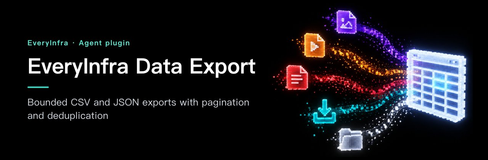

# EveryInfra Data Export — Bounded CSV and JSON exports with pagination and deduplication

<!-- rq223-banner -->
<p align="center"></p>

<p align="center">
  <picture>
    <source media="(prefers-color-scheme: dark)" srcset="assets/hero-dark.svg">
    <source media="(prefers-color-scheme: light)" srcset="assets/hero-light.svg">
    
  </picture>
</p>

<p align="center">
  <a href="https://cursor.com/en/install-mcp?name=everyinfra&config=eyJ1cmwiOiJodHRwczovL2FwaS5ldmVyeWluZnJhLmNvbS9tY3AiLCJoZWFkZXJzIjp7IkF1dGhvcml6YXRpb24iOiJCZWFyZXIgPEFQSSBLZXk%2BIn19"></a>
  <a href="https://vscode.dev/redirect/mcp/install?name=everyinfra&config=%7B%22type%22%3A%22http%22%2C%22url%22%3A%22https%3A%2F%2Fapi.everyinfra.com%2Fmcp%22%2C%22headers%22%3A%7B%22Authorization%22%3A%22Bearer%20%3CAPI%20Key%3E%22%7D%7D"></a>
  <a href="https://github.com/everyinfra/everyinfra-agent-plugins#claude-code"></a>
  <a href="https://github.com/everyinfra/everyinfra-agent-plugins#codex"></a>
</p>

<p align="center">
  <a href="https://github.com/everyinfra/everyinfra-agent-plugins/stargazers"></a>
  &nbsp;<b>Star the main repo and get $1 in credit.</b> <a href="https://everyinfra.com/en/docs?utm_source=github&utm_medium=readme&utm_campaign=everyinfra-data-export-plugin&utm_content=star_line#quickstart">How to claim →</a>
</p>

<p align="center"><b>English</b> · <a href="README.zh-CN.md">简体中文</a> · <a href="README.es.md">Español</a></p>

> [!TIP]
> **This repository holds one skill: EveryInfra Data Export.** The complete EveryInfra plugin (10 skills, the remote MCP server at `https://api.everyinfra.com/mcp`, and setup for Claude Code, Codex, Cursor and VS Code) lives in **[everyinfra/everyinfra-agent-plugins](https://github.com/everyinfra/everyinfra-agent-plugins)**. The buttons above connect the MCP server; the per-host plugin installs are in the main repo.

[Setup](docs/setup.md) · [Workflow](docs/workflow.md) · [Prompts](examples/prompts.md) · [Capability reference](docs/reference.md) · [API documentation](https://api.everyinfra.com/docs)

EveryInfra Data Export is a standalone agent skill for bounded CSV and JSON exports using EveryData MCP. It controls row and cost limits, checks pagination progress, deduplicates records and verifies the final file before reporting delivery.

Fetching records is only part of delivering a usable dataset. EveryInfra Data Export adds a row target, selected fields, a cost or time ceiling, pagination stop conditions, documented deduplication and a final file check to a supported EveryData action.

Use it when the user expects a concrete CSV or JSON artifact. The skill instructs the agent to collect and validate that artifact with its available filesystem tools; it does not bundle a general-purpose crawler or a prebuilt export service.

## What you can do

- Collect a requested number of supported public records without an unbounded loop.
- Preserve nested data in JSON or keep CSV headers stable across pages.
- Deliver a file with an honest record count, duplicate count and truncation explanation.

## Quick start

This is a standalone, one-skill **MCP workflow** package, not a new API service. It requires a compatible agent host and the configured access described in [setup](docs/setup.md). Local package validation does not establish live API availability.

Install the source repository in Codex after reviewing its contents. These commands add a GitHub-backed repository catalog, not an official marketplace endorsement:

```bash
codex plugin marketplace add everyinfra/everyinfra-data-export-plugin
codex plugin add everyinfra-data-export@everyinfra-data-export-plugin
```

For a local checkout, replace the first command's source with `.`. [Setup](docs/setup.md) also covers Claude Code and the separate service connection.

Configure access once, then ask:

> Plan a CSV export of up to the row limit I specify. Inspect supported fields, pagination and estimated calls before collecting data.

This initial prompt is scoped to inspection or preparation. Review any paid operation or external side effect before proceeding. Claude Code instructions and Cursor packaging boundaries are in [setup](docs/setup.md).

## How the workflow works

1. Confirm source, requested rows, selected fields, output format, destination and time or cost ceiling.
2. Discover the action schema with everyinfra_list_capabilities, including pagination and max_limit.
3. Estimate calls where the contract allows; obtain approval before material spending.
4. Use everyinfra_call_api with bounded retries and stop when the target, budget, final page or a non-advancing cursor is reached.
5. Deduplicate using a stable ID or a documented composite key; write the selected fields.
6. Verify file existence, non-empty content, parseability and actual row counts. Report requested versus delivered rows and all truncation causes.

### What a useful result contains

A real, parseable file plus requested and delivered counts, the deduplication rule, stop reason and observed billing. A reported path is not a delivered artifact unless the file actually exists and passes validation.

## When to use this skill

EveryData focuses on querying the product contract. Data Export owns the end-to-end bounded file outcome. The standalone skill includes the necessary discovery and collection instructions; another plugin checkout is not required.

## Limits and safety

- No unlimited export, full-platform coverage or unbounded retry promise.
- Do not retry authorization, parameter, inventory or balance failures as transient errors.
- Do not silently fuzzy-deduplicate distinct records or flatten nested JSON without agreement.

The package contains one skill and does not grant permissions or register a duplicate MCP connection. Never put credentials in prompts, checked-in files, screenshots or shared logs. Discovery, API execution, billing and a final external result are separate states. See [security](SECURITY.md).

## Frequently asked questions

### Can I ask for every record?

The workflow needs a practical row, time or cost bound and must respect the source’s supported pagination. It cannot promise exhaustive coverage without evidence.

### When should I choose JSON instead of CSV?

Choose JSON when nested structures need to remain intact. CSV is useful for a stable selected field set with explicit serialization choices.

### What counts as a complete export?

The file exists, parses, matches the agreed structure and reports the actual delivered scope. A target not reached must be described as partial, with the stop reason.

## Validate and contribute

```bash
python3 scripts/validate.py
```

This offline check validates packaging, local documentation links, the single-skill boundary, metadata and fixtures. It does not send messages, allocate resources or verify a production account. [Contribution guidance](CONTRIBUTING.md) and [the release checklist](RELEASING.md) describe the remaining checks.

Source publication, tagged releases, official marketplace acceptance and live service verification are separate milestones. Maintained by [EveryInfra](https://everyinfra.com). Licensed under [Apache-2.0](LICENSE).
